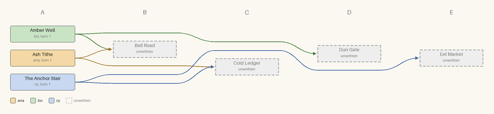

# Example: a lexicon of a river town: who cites whom

Turn 2 of 24: 3 written, 4 unwritten.

Columns are turns. Boxes are coloured by author; dashed grey ones are cited but not yet written.

## As text

- **Amber Well** (bo, turn 1) cites *Dun Gate*, *Bell Road*
- **Ash Tithe** (ana, turn 1) cites *Bell Road*, *Cold Ledger*
- **The Anchor Stair** (cy, turn 1) cites *Cold Ledger*, *Eel Market*

*Italic* titles are unwritten.
